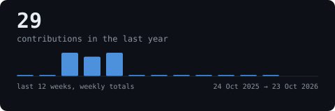
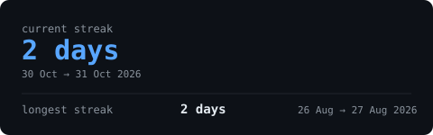
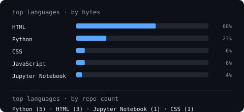
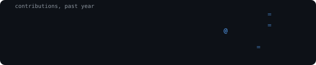

<!--
  Portrait slot — reserved for later. Run scripts/generate_portrait.py with
  a photo (see SETUP.md), then uncomment this block. Left out for now
  rather than pointing at a file that doesn't exist yet.

  <picture>
    
  </picture>
    
-->

<samp>naman agarwal</samp>
 
ai/ml engineer + cybersecurity intern @ skillorbit. i build the model, the detection tool, or the live dashboard, and ship it end to end.
 
<a href="https://namanagr26.github.io/Portfolio/">portfolio</a> · <a href="https://namanagr26.github.io/Portfolio/assets/Naman_Agarwal_Resume.pdf">resume</a> · <a href="mailto:just.namanagarwal@gmail.com">just.namanagarwal@gmail.com</a>

  

<samp>now</samp>
 
cybersecurity intern at skillorbit (aug 2026 – present): web application VAPT across 8 OWASP vulnerability classes with burp suite, external recon with shodan + nmap, and a packet-capture intrusion detection tool built from scratch.

  

<samp>security</samp>

| project | what it is |
|---|---|
| [network-traffic-analyzer](https://github.com/namanagr26/Network-Traffic-Analyzer) | packet capture + intrusion detection. scapy, sqlite, streamlit. ~138k packets in lab testing; flags port scans, ssh/rdp brute force, traffic spikes and unknown ips |

<samp>ml + data</samp>

| project | what it is |
|---|---|
| [race-outcome-predictor](https://github.com/namanagr26/Race-Outcome-Predictor) | gradient boosting on multi-season f1 data, leak-free form features, held-out test season |
| [f1-driver-coach](https://github.com/namanagr26/f1-driver-coach) | aligns two laps on a shared distance grid, turns braking/throttle deltas into coaching notes |
| [f1-race-summariser](https://github.com/namanagr26/f1-race-summariser) | race report from raw timing data: pit strategy, overtakes, race-control events |
| [plant-disease-diagnosis](https://github.com/namanagr26/plant-disease-diagnosis) | mobilenetv2 classifier (38 classes) + phi-3-mini llm writing treatment reports |
| [automated-audio-captioning](https://github.com/namanagr26/Automated-Audio-Captioning-System) | resnet18 + bert transformer, bleu-4 0.35 / meteor 0.40 on clotho v2 |

<samp>live</samp>

| project | what it is |
|---|---|
| [stoppage](https://github.com/namanagr26/stoppage) · [live](https://stoppageyukar1.netlify.app) | fifa world cup 2026: all 104 matches, groups and bracket, zero manual updates |
| [the-crease](https://github.com/namanagr26/the-crease) · [live](https://the-crease.netlify.app) | ipl 2026: countdown, squad cards, pitch intelligence via playwright |
| [f1-dashboard](https://github.com/namanagr26/F1-Dashboard) · [live](https://f1yukar1.netlify.app) | live f1 standings and results from the jolpica api |

 

 

  

  

  

  

<blockquote>
the focus now is where ai and security meet: models, detection tooling, and
the dashboards that put both in front of people.
  
every graphic above is generated inside this repository by a scheduled
action, straight from the GitHub API — no third-party stats services,
nothing that can rate-limit or go dark.
</blockquote>
